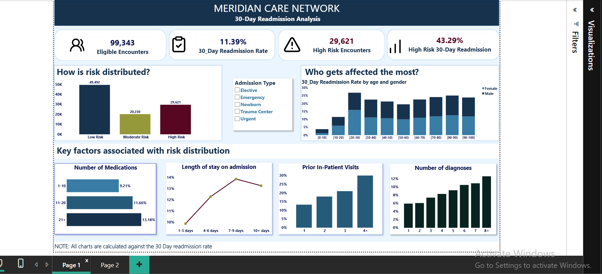
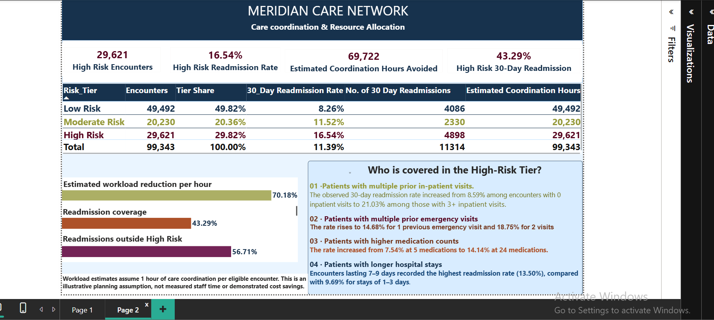

# 30-Day Diabetes Readmission Analysis

# Project Overview

Hospital readmissions place additional pressure on healthcare resources and may indicate opportunities to improve the quality and continuity of patient care.

This project examines hospital encounters involving patients with diabetes to identify factors associated with readmission within 30 days of discharge. It was developed as a healthcare analytics case study for a fictional healthcare organisation, **Meridian Care Network**, with the objective of helping its Population Health Group identify patient groups that may benefit from more targeted post-discharge support.

Using historical hospital encounter data, I explored readmission patterns, developed an explainable risk-stratification framework, and translated the findings into interactive Power BI dashboards and a memorandum outlining recommendations for the organisation's leadership.

# Business Problem

Meridian Care Network wants to reduce avoidable hospital readmissions among patients with diabetes.

However, providing intensive follow-up and care coordination to every discharged patient may place considerable demands on available resources.

The analysis seeks to answer three questions:

1. What patient and encounter characteristics are associated with higher 30-day readmission rates?
2. Can patients be grouped into risk categories using observable characteristics from their hospital records?
3. Could a targeted approach to care coordination help the organisation prioritise its limited resources?

**Primary analytical question:** Which hospital encounters involving patients with diabetes are associated with a higher likelihood of readmission within 30 days?

# Dataset

The analysis uses the **Diabetes 130-US Hospitals for Years 1999–2008** dataset, obtained from the UCI Machine Learning Repository.

The original dataset contains:

- 101,766 hospital encounters.
- 50 variables.
- Patient demographic information, admission details, diagnoses, medication records, laboratory results and previous healthcare utilisation.

Each row represents a hospital encounter, rather than a unique patient. A patient may therefore appear multiple times in the dataset.

**Source:** [UCI Machine Learning Repository – Diabetes 130-US Hospitals](https://archive.ics.uci.edu/dataset/296/diabetes+130+us+hospitals+for+years+1999+2008)

## Tools and Technologies

- **Power BI Desktop:** Data modelling, DAX calculations, dashboard development and visualisation.
- **Power Query:** Data cleaning, transformation, merging and preparation.
- **DAX:** Calculated columns, measures, readmission metrics and risk scoring.

## Methodology

### 1. Data Cleaning and Preparation

The original dataset was inspected and transformed using Power Query.

Key preparation activities included:

- Removing blank rows.
- Trimming excess spaces and cleaning hidden characters.
- Standardising text formatting.
- Reviewing and correcting data types.
- Identifying missing and unknown values.
- Replacing question-mark placeholders with `Unknown` where appropriate.
- Excluding the weight variable from the analysis because approximately 96.9% of its values were missing.
- Excluding medical specialty from the risk-screening analysis because of substantial missingness.
- Merging admission type, discharge disposition and admission source descriptions using reference queries created from the IDS mapping file.
- Creating calculated fields and filtering records outside the defined analytical cohort.

Diagnosis fields were treated as classification codes rather than numerical measurements. They can contain alphanumeric values, making preservation of their original codes important.

### 2. Defining the Analytical Cohort

The original dataset contained 101,766 encounters.

A total of 2,423 encounters were excluded based on discharge disposition because they represented deaths or hospice discharges. The remaining 99,343 encounters formed the eligible analytical cohort.

The exclusion covered the following discharge disposition codes:

- 11 – Expired
- 13 – Hospice/home
- 14 – Hospice/medical facility
- 19 – Expired at home
- 20 – Expired in a medical facility
- 21 – Expired, place unknown

Other discharge dispositions, including transfers, were retained.

### 3. Measuring 30-Day Readmission

The primary outcome was whether an eligible encounter was followed by a readmission within 30 days.

The analysis identified 11,314 readmissions within 30 days, representing an overall readmission rate of **11.39%**.

Readmission rates were examined across several dimensions, including:

- Age group.
- Admission type.
- Length of hospital stay.
- Previous inpatient admissions.
- Previous emergency department visits.
- Number of diagnoses.
- Number of medications.
- Selected laboratory results.

## Technical Implementation

### 1. Risk Score Calculation (DAX)

To stratify encounters by observed readmission risk, I developed a points-based scoring framework using five variables:

| Variable | Scoring criteria |
|---|---|
| Previous inpatient visits | 0 = 0 points; 1 = 1 point; 2+ = 2 points |
| Previous emergency visits | 0 = 0 points; 1 = 1 point; 2+ = 2 points |
| Length of stay | 1–3 days = 0 points; 4+ days = 1 point |
| Number of diagnoses | 1–5 = 0 points; 6–7 = 1 point; 8+ = 2 points |
| Number of medications | 1–10 = 0 points; 11–20 = 1 point; 21+ = 2 points |

The scoring logic was implemented using nested `IF()` statements in DAX.

```dax
Risk_Score =
IF(
    'diabetic_encounter_raw(1)'[number_inpatient] = 1, 1,
    IF('diabetic_encounter_raw(1)'[number_inpatient] >= 2, 2, 0)
)
+
IF(
    'diabetic_encounter_raw(1)'[number_emergency] = 1, 1,
    IF ('diabetic_encounter_raw(1)'[number_emergency]>= 2, 2, 0)
)
+
IF('diabetic_encounter_raw(1)'[time_in_hospital] >= 4, 1, 0)
+
IF(
    'diabetic_encounter_raw(1)'[number_diagnoses] >= 8, 2,
    IF('diabetic_encounter_raw(1)'[number_diagnoses] >= 6, 1, 0)
)
+
IF(
    'diabetic_encounter_raw(1)'[num_medications] >= 21, 2,
    IF('diabetic_encounter_raw(1)'[num_medications] >= 11, 1, 0)
)
```
## Dashboard Preview

### Dashboard 1: Readmission Overview



### Dashboard 2: Risk Stratification and Resource Allocation


